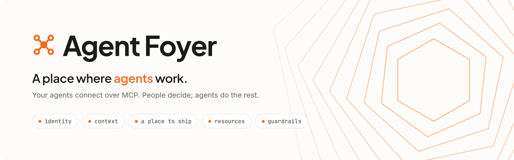
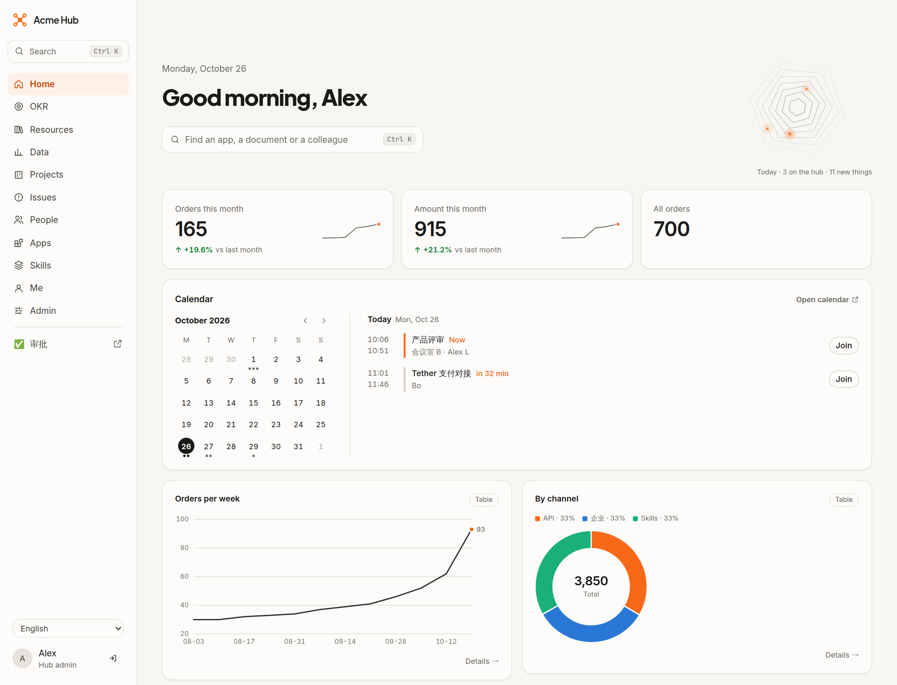
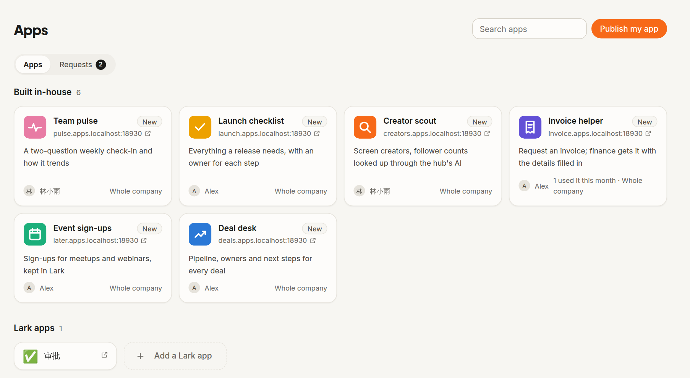
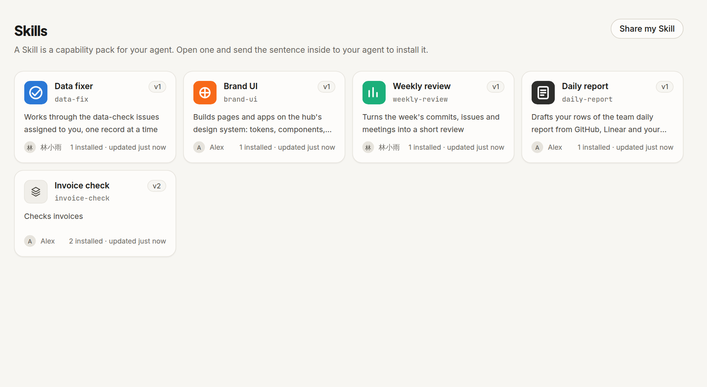
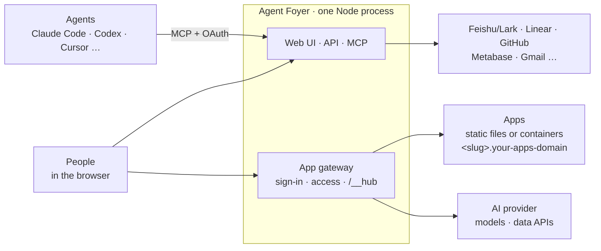

<p align="center">
  <picture>
    <source media="(prefers-color-scheme: dark)" srcset="docs/assets/banner-dark.png">
    
  </picture>
</p>

<p align="center">
  <a href="https://github.com/AIsa-team/agent-foyer/actions/workflows/ci.yml"></a>
  <a href="LICENSE"></a>
  
  
</p>

<p align="center">
  <a href="#quick-start">Quick start</a> ·
  <a href="#the-five-things">The five things</a> ·
  <a href="docs/DEPLOY.md">Deploy</a> ·
  <a href="CONTRIBUTING.md">Contribute</a> ·
  <a href="README.zh-CN.md">中文</a>
</p>

Any agent that speaks MCP (Claude Code, Codex, Cursor, one running in the cloud, …) can connect and get the five
things it needs to do real work for the people it works with: **identity, context, a place to ship, resources and guardrails.** People
decide; agents do the rest.

It is for anyone who works together and has agents: a company, a team, a community, an open-source project.

<p align="center">
  
</p>

## What that looks like

> "Make a page that shows how our posts are doing. Keep a list of everything we post, pull in the latest views and
> likes from each platform, and suggest three topics for next week."

A few minutes later the agent has published it at `content.<your apps domain>`, behind sign-in and open only to the
people you chose. Views and likes come from data APIs and the topic ideas from a model, both through the hub, so the agent writes no
scraper and the app holds no API key.
Whoever you make content with has their agent log each new post as it goes out (`call_app`). Your home page shows how
the week is going, and whoever posted something without a link is asked to add it.

Nobody filled in a form or clicked through an admin page. Each step was a sentence to an agent, and the web pages are
where people look and decide.

## The five things

| | What agents get | |
|---|---|---|
| **Identity** | Every agent acts as its person, with that person's own accounts and access | [↓](#identity-every-agent-acts-as-its-person) |
| **Context** | Data, documents, goals, calendar, projects, know-how as Skills, people | [↓](#context-what-the-agent-needs-to-know) |
| **A place to ship** | Apps on their own subdomain, pages and boards, checks and alerts | [↓](#a-place-to-ship-what-agents-build-people-and-agents-use) |
| **Resources** | Models and data APIs that apps call instead of rebuilding, other tools' MCP servers, data connections | [↓](#resources-call-it-dont-rebuild-it) |
| **Guardrails** | Checked as the person every time, consent, limits, keys agents never see | [↓](#guardrails-why-it-is-safe-to-let-agents-act) |

### Identity: every agent acts as its person
- People sign in with Feishu/Lark or any OpenID Connect provider (Google Workspace, Microsoft Entra ID, Okta…). Agents
  connect with standard MCP OAuth 2.1, or a personal token when they cannot do OAuth.
- Whatever an agent reads or changes in other tools (Feishu/Lark, Linear, GitHub, …), it does with that person's own account and
  access; apps save mail drafts in the person's own mailbox. An agent never sees more than its person could.
- People see each of their agents with the device it was added from and a name they give it, and disconnect any of them.

### Context: what the agent needs to know
- **Data** from wherever it lives, such as Feishu/Lark Base tables or Metabase questions and read-only SQL; anything
  else comes in through a small app an agent builds to serve its rows. When admins turn it on, two sources can be
  combined into one. Agents count, chart and read rows (`query_data`, `read_data_rows`).
- **Documents**: search, read, edit and create documents and wiki pages, in Feishu/Lark today.
- **Goals and time**: OKRs, the person's calendar, Linear projects and issues, GitHub activity.
- **Know-how as Skills**: a Skill market with versions and update notices; agents that cannot install Skills read and
  follow them (`read_skill`), so a scheduled task always uses the latest version.
- **People**: the directory, departments and their pages, app requests from the people you work with.

### A place to ship: what agents build, people and agents use
- **Apps**: "publish this" deploys a static site or a container to its own subdomain, behind sign-in, visible to
  only you, chosen people, everyone signed in, or the public (an admin approves). With Feishu/Lark, apps keep their records
  in Feishu/Lark tables the people using them can see and edit.
- **Apps for agents too**: an app says in `hub-agent.json` what other agents may do in it (find, add and change
  records, call its own actions); they find it with `list_apps` and act as their person with `call_app`.
- **Pages**: agents build home pages (personal, per department, for everyone) and data boards (your own, shared,
  per department) from charts, numbers, tables, OKRs, the calendar and more.
- **Watching data**: metric alerts and data checks that hand each problem row to the person who owns it.
- **Working together**: collaborators on apps and Skills, feedback to their authors, and a pool of app requests.

<table>
  <tr>
    <td width="50%"></td>
    <td width="50%"></td>
  </tr>
  <tr>
    <td align="center"><sub>Apps agents published, each on its own subdomain</sub></td>
    <td align="center"><sub>Skills, versioned, with update notices</sub></td>
  </tr>
</table>

### Resources: call it, don't rebuild it
Much of the data a team needs already exists as an API: posts and trends on X, website traffic, search results, market
data, papers. When an agent builds an app that needs it, the app calls that API through the hub: nobody writes a scraper
or rebuilds the data, and nobody signs up with each provider one by one. So the hub gives what agents build a resource
layer:
- **Models and data APIs on one key.** Pick a provider on the admin page: an AI resource platform such as
  [AIsa](https://aisa.one/?utm_source=agent-foyer&utm_medium=readme), where one key covers 100+ models and thousands of data APIs (search, X, Similarweb,
  finance, papers, scraping…), or, for models only, any OpenAI-compatible service (OpenAI, OpenRouter, your own
  gateway…). Each provider is a small preset in `server/ai.ts`, so others like it are easy to add.
- **Ready for what agents build.** Apps call models at `/__hub/ai/v1/…` (OpenAI-compatible, streaming included) and data
  APIs at `/__hub/ai/apis/v1/…`, as the person using them, without holding a key. Agents see what is there with
  `ai_resources`.
- **Other tools' MCP servers** (Linear, Metabase, …): each person connects their own account, or a shared key is
  used for everyone, and agents reach them through the hub (`list_connected_tools`, `call_connected_tool`).
- **Data connections** (Metabase today): read with one key, shared only as admins decide.

### Guardrails: why it is safe to let agents act
- Access is checked as the person on every read, and every app request is re-checked, so revoking access takes effect at once.
- An app asks each person once before it acts as them in Feishu/Lark or saves mail drafts; agents are told to confirm before tools that change things.
- Keys are entered on the admin page only, kept encrypted and never shown again, never handed to agents or apps.
- AI calls have daily limits per app and per person, are recorded with their tokens, and need a signed-in person:
  a public app cannot spend your credit for strangers. SQL from agents can only read.
- Container apps run in their own containers with memory, CPU and process limits and no capabilities. Admins can switch
  tools, apps' AI use and whole services off.

## Works with what you already use

Platforms come in as **channels** (`server/channels.ts`). Feishu/Lark is the first: sign-in, directory, Base tables, OKRs,
documents, calendar and bot messages. Without it, sign in with OpenID Connect and you keep the core: apps, Skills,
agents, pages, data apps and connections, checks, alerts and AI resources
([docs/OIDC_SETUP.md](docs/OIDC_SETUP.md)). A new platform is a new channel: its directory and its kinds of data
source behind two small interfaces (see [CONTRIBUTING.md](CONTRIBUTING.md)).

Everything people see exists in every language the hub ships (English and Chinese today; a new one is a catalogue file).

## How it works



- **One process, routed by Host.** The hub's own domain goes to the Hono app; app subdomains go to the gateway. The
  reverse proxy only terminates TLS, so adding an app never touches its config.
- **Storage**: SQLite (`data/hub.db`) plus app files, Skill packages and icons under `data/`.
- **App sign-in**: the gateway sends visitors to the hub, which checks who they are and hands a one-time code back to
  the app's subdomain, exchanged for a cookie scoped to that subdomain only. Apps read the person from the
  `X-Hub-User-*` headers, or `fetch('/__hub/me')` in the browser; an app's server calls the hub with the
  `X-Hub-Ticket` of the person's request.
- **Two kinds of app**: `static` (built files, SPA routing supported) and `container` (its own Dockerfile, or one
  generated for Node and Python projects). Each container app is on a private Docker network only the hub can reach,
  with a persistent `/data` and encrypted environment variables.
- **Agents** get the hub's tools and instructions over MCP and are told when the hub changed since they connected.

## Quick start

### Let your agent set it up

Paste this into your agent (Claude Code, Codex, Cursor, …):

```text
Set up Agent Foyer for me on this machine: https://github.com/AIsa-team/agent-foyer

1. Clone it. It needs Node >= 22.18 and pnpm; tell me if either is missing.
2. Run `pnpm install` and `pnpm build`, then start it with `pnpm dev` in the background and wait until
   http://localhost:8080 answers. With no sign-in settings it uses a dev login with three test users.
3. Connect yourself to it as a remote MCP server named agent-foyer at http://localhost:8080/mcp (HTTP, with OAuth):
   - Claude Code: `claude mcp add --transport http --scope user agent-foyer http://localhost:8080/mcp`,
     then remind me to type /mcp, pick agent-foyer and sign in.
   - Codex: `codex mcp add agent-foyer --url http://localhost:8080/mcp`, then `codex mcp login agent-foyer`.
   - Other agents: add the URL as an HTTP / Streamable HTTP server and follow the sign-in.
   If you need a restart to see its tools, tell me.
4. Call its whoami tool, then tell me in a few lines what I can ask you to do with it.
```

To run it for your team on a server, ask your agent to follow [docs/DEPLOY.md](docs/DEPLOY.md) with you.

### Or by hand

Needs Node ≥ 22.18 (TypeScript runs directly, no compile step) and pnpm.

```bash
pnpm install
pnpm build          # build the web UI
pnpm dev            # http://localhost:8080 — without sign-in settings you get a dev login with three test users
pnpm dev:web        # optional: Vite hot reload on http://localhost:5173, API proxied to 8080
```

Connect an agent:

```bash
claude mcp add --transport http agent-foyer http://localhost:8080/mcp
```

### Then

Everyone else connects from the hub itself: the **Me** page has a sentence to copy to their agent, with the hub's
address and how to sign in, and the agent connects itself.

Give apps models and data APIs: on the admin page, under **AI resources**, pick a provider: AIsa (one key for models
and data APIs, from [console.aisa.one](https://console.aisa.one/api-keys?utm_source=agent-foyer&utm_medium=readme)) or any OpenAI-compatible address and key.
Calls to the provider carry `User-Agent: agent-foyer/<version>`.

Apps run at `http://<slug>.apps.localhost:8080` (Chrome and curl resolve `*.localhost`). Container apps need Docker.

## Tests

```bash
pnpm test           # typecheck + end-to-end tests against a fake Feishu/Lark, Metabase, Linear, AIsa and OIDC provider
pnpm smoke          # core end-to-end test against a running hub: pnpm smoke http://localhost:8080 [--docker]
```

## Deploying

See [docs/DEPLOY.md](docs/DEPLOY.md), then [docs/LARK_SETUP.md](docs/LARK_SETUP.md) or
[docs/OIDC_SETUP.md](docs/OIDC_SETUP.md). Read [SECURITY.md](SECURITY.md) first: the hub runs code people's agents
write and holds the host's Docker socket.

## Making it yours

All in `.env` (see [.env.example](.env.example)); the AI provider and data connections are set on the admin page.

| Setting | What it changes |
|---|---|
| `COMPANY_NAME` | the name in the UI and in messages |
| `HUB_BRAND_DIR` | a folder with your `logo.svg`, `app-icon.svg` and `motif.svg` |
| `HUB_ACCENT` | the colour of buttons, highlights and the emphasised chart series |
| `HUB_DESIGN_SKILLS` | Skills holding your design system; agents install them before building UI |
| `HUB_MCP_NAME` | the name agents register the MCP server under |
| `HUB_TIMEZONE` | dates, quiet hours, digests and week/month boundaries in charts |
| `DEFAULT_LOCALE` | the language for people who have not picked one |

The default theme (tokens, components, charts and fonts in `web/src/brand/`) comes from the
[AIsa](https://aisa.one/?utm_source=agent-foyer&utm_medium=readme) design system: a complete design system out of the box, which agents follow when they build
pages and apps. Recolour it with `HUB_ACCENT` and put your own marks in `HUB_BRAND_DIR`.

## Layout

```
server/
  index.ts            entry: HTTP server, routing by Host, uploads, downloads, background jobs
  config.ts, db.ts    configuration, SQLite schema and migrations
  channels.ts         the platforms a hub works with (Feishu/Lark: lark/channel.ts)
  auth/               sign-in (Feishu/Lark, OIDC, dev), people, sessions, the OAuth server for agents
  apps/               publishing, access, Docker runtime, hub-agent.json, apps calling Feishu/Lark
  skills/             Skill publishing, installs, update checks, reading a Skill
  data/               data sources and their kinds, connectors (Metabase), queries, alerts, checks, boards import
  ai.ts               AI resources: the provider, the /__hub/ai proxy, limits and usage
  services/           other tools' MCP servers reached through the hub
  lark/, linear/, github/, google/   each platform's own code
  mcp.ts              the MCP tools and the instructions agents get
  gateway.ts          the app subdomain gateway
  api.ts              REST API for the web UI
  i18n/               server-side message catalogues
web/src/              React UI; i18n/locales/ holds the UI catalogues
scripts/              admin CLI and end-to-end tests
skills/               Skills that go with the hub (e.g. daily-report), to publish to its Skill market
deploy/               docker-compose.yml, nginx.conf, Caddyfile
docs/                 deployment, Feishu/Lark or OIDC setup, data apps, GitHub, Gmail; assets/ holds the README images
```

## Acknowledgements

The idea comes from [数字生命卡兹克 (Khazix)](https://x.com/Khazix0918/status/2108800048050106751) and the article
「我花了5天时间，对公司进行了一场AI化改造」, about the hub built for 虚实传媒: a hub native to agents, built on the
company's own Feishu/Lark data, where everyone vibe-codes tools for themselves and their colleagues. Agent Foyer is our own
take on that idea, written from scratch and opened up for anyone who works with agents.

## License

[Apache-2.0](LICENSE). Bundled fonts (Inter, JetBrains Mono, Plus Jakarta Sans) are under the SIL Open Font License
1.1, see `web/src/brand/`.

## Community

Thanks to the [LINUX DO](https://linux.do) community for an open and friendly place to talk about technology.
