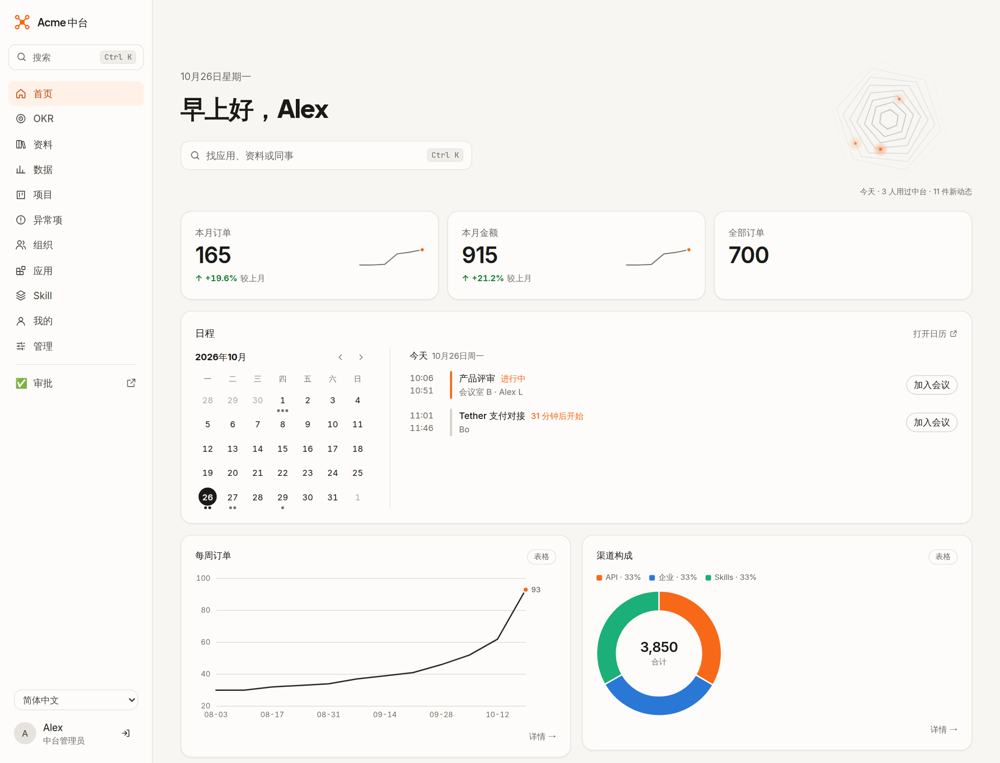
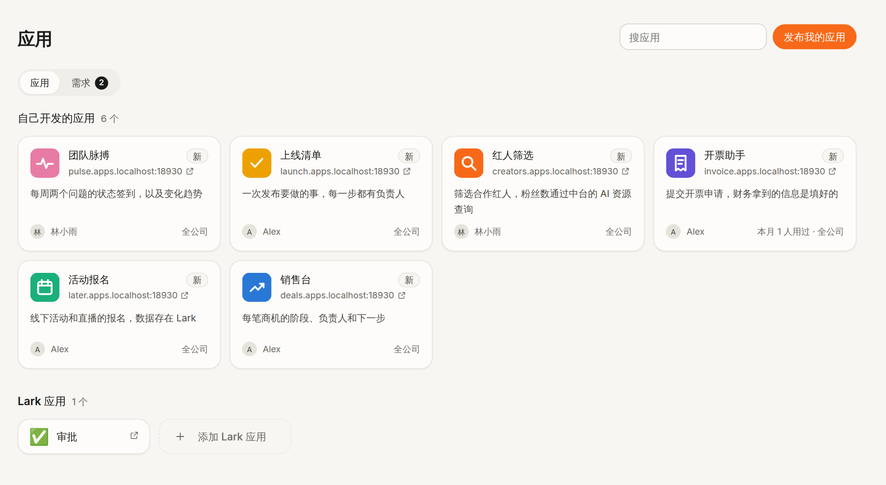
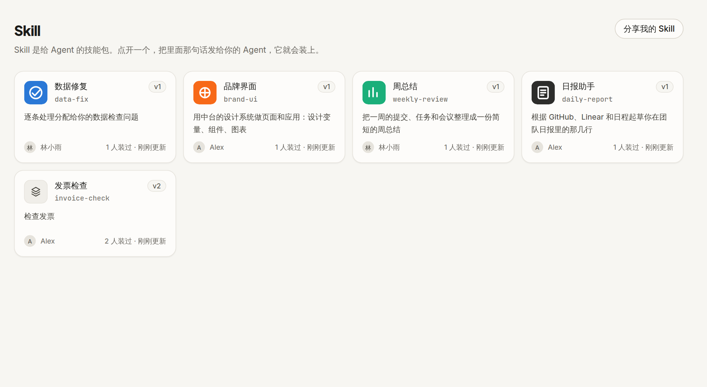
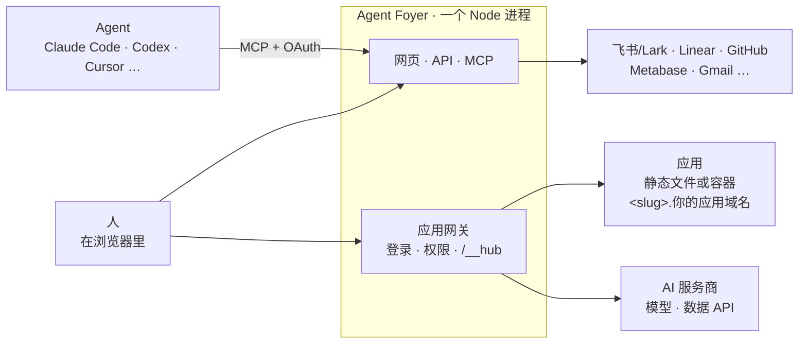

<p align="center">
  <picture>
    <source media="(prefers-color-scheme: dark)" srcset="docs/assets/banner-dark.png">
    
  </picture>
</p>

<p align="center">
  <a href="https://github.com/AIsa-team/agent-foyer/actions/workflows/ci.yml"></a>
  <a href="LICENSE"></a>
  
  
</p>

<p align="center">
  <a href="#快速开始">快速开始</a> ·
  <a href="#五样东西">五样东西</a> ·
  <a href="docs/DEPLOY.zh-CN.md">部署</a> ·
  <a href="CONTRIBUTING.md">参与贡献</a> ·
  <a href="README.md">English</a>
</p>

**一个让 Agent 干活的地方。** 只要支持 MCP，你的 Agent 就能接进来，比如 Claude Code、Codex、Cursor，或者跑在云上的 Agent。要真正替人干活，Agent 需要五样东西：**身份、上下文、发布的地方、资源和护栏**，这里都给它准备好了。人来拍板，剩下的交给 Agent。

不管是公司、团队、社区还是开源项目，只要大家一起干活、又都在用 Agent，就用得上。

<p align="center">
  
</p>

## 用起来是什么样

> 「做个页面，看看我们的内容表现怎么样。发过的每条内容都记下来，把各平台最新的播放和点赞拉过来，再给下周推荐三个选题。」

几分钟后，Agent 就把页面发布到了 `content.<你的应用域名>`。页面自带登录，只有你选的人能打开。播放和点赞来自数据 API，选题建议来自模型，都经过中台，Agent 不用自己写爬虫，应用里也一个 API key 都不放。

之后，一起做内容的人每发一条，让自己的 Agent 用 `call_app` 顺手登记一下就行。你的首页上能看到本周表现。哪条内容漏填了链接，谁发的就提醒谁。

整个过程没人填表，也没人进后台点来点去。每一步都只是跟 Agent 说一句话，网页留给人看结果、做决定。

## 五样东西

| | Agent 拿到什么 | |
|---|---|---|
| **身份** | 每个 Agent 都用本人的身份、账号和权限做事 | [↓](#身份agent-以你的名义做事) |
| **上下文** | 数据、文档、目标、日程、项目，沉淀成 Skill 的做法，还有人 | [↓](#上下文agent-该知道的事) |
| **发布的地方** | 有独立子域名的应用，首页和看板，数据检查和提醒 | [↓](#发布的地方agent-做出来人和-agent-都能用) |
| **资源** | 应用直接调的现成模型和数据 API，其他工具的 MCP 服务，数据连接 | [↓](#资源现成的直接调不用重做) |
| **护栏** | 每次都按本人权限检查，先征得同意，用量有限额，key 不经 Agent 之手 | [↓](#护栏为什么敢让-agent-动手) |

### 身份：Agent 以你的名义做事
- 登录可以用飞书/Lark，也可以用任何 OpenID Connect 服务，比如 Google Workspace、Microsoft Entra ID、Okta。Agent 走标准的 MCP OAuth 2.1 接入；不支持 OAuth 的 Agent 用个人令牌。
- Agent 读写飞书/Lark、Linear、GitHub 这些工具时，用的都是你自己的账号和权限，看到的永远不会比你多。应用帮你存邮件草稿，也是存进你自己的邮箱。
- 每个人都能看到自己的每个 Agent 是从哪台设备接进来的，可以给它起名字，也能随时断开。

### 上下文：Agent 该知道的事
- **数据**：数据放在哪都能接，比如飞书/Lark 多维表格、Metabase 的问题或只读 SQL；其他系统的数据，让 Agent 做个小应用提供出来就行。管理员打开组合数据源之后，还能把两份数据关联或合并起来用。Agent 可以统计、画图，也能读具体的行，用的是 `query_data` 和 `read_data_rows`。
- **文档**：目前是飞书/Lark 的文档和知识库页面，能搜、能读、能改，也能新建。
- **目标和时间**：OKR、你的日历、Linear 里的项目和任务，还有 GitHub 动态。
- **把做法沉淀成 Skill**：有一个 Skill 市场，Skill 带版本，有更新会提醒。装不了 Skill 的 Agent 可以用 `read_skill` 直接读来照做；定时任务每次跑都用最新版。
- **人**：通讯录、部门和部门主页，以及大家提的应用需求。

### 发布的地方：Agent 做出来，人和 Agent 都能用
- **应用**：说一句「发布这个」，静态网站或容器就会部署到独立的子域名上，自带登录。可见范围有四档：只有自己、指定的人、所有登录的人，以及公开（需要管理员审批）。接了飞书/Lark 的话，应用的数据存在飞书/Lark 表格里，用它的人都能看、能改。
- **应用也给 Agent 用**：应用在 `hub-agent.json` 里写明别的 Agent 能在里面做什么，包括查、加、改记录，以及调用应用自己的操作。Agent 先用 `list_apps` 找到应用，再用 `call_app` 以本人身份操作。
- **页面**：Agent 用图表、数字、表格、OKR、日程这些模块搭页面。首页可以是个人的、部门的或所有人的；数据看板可以是自己的、分享的或部门的。
- **盯着数据**：指标可以设提醒；数据检查会把每条有问题的记录交给它的负责人。
- **一起做**：应用和 Skill 可以加协作者，用的人能给作者反馈，还有一个应用需求池。

<table>
  <tr>
    <td width="50%"></td>
    <td width="50%"></td>
  </tr>
  <tr>
    <td align="center"><sub>Agent 发布的应用，每个都有自己的子域名</sub></td>
    <td align="center"><sub>Skill 市场，带版本和更新提醒</sub></td>
  </tr>
</table>

### 资源：现成的直接调，不用重做
团队要用的很多数据，早就有现成的 API 了，比如 X 上的帖子和趋势、网站流量、搜索结果、金融行情、论文。Agent 做应用的时候，让应用经过中台直接调这些 API 就行，不用自己写爬虫、攒数据，也不用每家服务都去注册、对接一遍。所以中台给 Agent 做的应用准备了一层资源：
- **模型和数据 API，一个 key 就够。** 在管理页选一个服务商。可以是 [AIsa](https://aisa.one) 这类 AI 资源平台，一个 key 就能用上百个模型和几千个数据 API，比如搜索、X、Similarweb、金融、论文、抓取；只用模型的话，任何兼容 OpenAI 的服务也行，比如 OpenAI、OpenRouter 或自建网关。每个服务商在 `server/ai.ts` 里只是一小段预设，同类平台很容易加进来。
- **Agent 做的应用直接调。** 应用调模型走 `/__hub/ai/v1/…`，兼容 OpenAI，支持流式输出；调数据 API 走 `/__hub/ai/apis/v1/…`。调用时用的是使用者本人的身份，应用里不放 key。Agent 用 `ai_resources` 就能查到现在有哪些资源。
- **其他工具的 MCP 服务**：比如 Linear、Metabase。可以每人连自己的账号，也可以大家共用一个 key。Agent 通过中台的 `list_connected_tools` 和 `call_connected_tool` 来用它们。
- **数据连接**：目前支持 Metabase。用一个 key 读取，给谁看由管理员决定。

### 护栏：为什么敢让 Agent 动手
- 每次读取都按本人的权限检查。打开应用时，每个请求都会重新检查，权限一收回就立刻生效。
- 应用第一次以某人的身份读写飞书/Lark、存邮件草稿之前，要先经过本人同意。中台还会要求 Agent 在调用会改东西的工具之前，先跟人确认。
- key 只在管理页填写，加密保存，填完就不再显示，也不会交给 Agent 或应用。
- AI 调用按应用、按人设每日限额，并记录 token 用量。调用的人必须已登录，所以公开应用不会替陌生人花你的额度。Agent 写的 SQL 只能读。
- 容器应用各自跑在自己的容器里，内存、CPU 和进程数都有上限，不给任何特权。管理员可以单独关掉某个工具或某个应用的 AI，也可以直接关掉整个服务。

## 接上你已经在用的平台

每个平台作为一个**渠道**接入，代码在 `server/channels.ts`。飞书/Lark 是第一个渠道，覆盖登录、通讯录、多维表格、OKR、文档、日历和机器人消息。

不用飞书/Lark 也行。用 OpenID Connect 登录，核心功能照样都在：应用、Skill、Agent、页面、数据应用和数据连接、检查、提醒、AI 资源。配置方法见 [docs/OIDC_SETUP.zh-CN.md](docs/OIDC_SETUP.zh-CN.md)。

想接一个新平台，加一个渠道就行：给它的通讯录和数据源类型各实现一个小接口，具体见 [CONTRIBUTING.md](CONTRIBUTING.md)。

界面文字都有中英文两套。想加一种语言，加一个词条文件就行。

## 怎么运作



- **一个进程，按域名分流。** 访问中台自己的域名，进的是网页和接口；访问应用子域名，进的是网关。反向代理只管 TLS，新加应用不用改它的配置。
- **存储**：数据库用 SQLite（`data/hub.db`），应用文件、Skill 包和图标都放在 `data/` 下。
- **应用登录**：网关先把访客送到中台确认身份，再带着一个一次性的码回到应用子域名，换成只在这个子域名有效的 cookie。应用看 `X-Hub-User-*` 请求头就知道是谁，在浏览器里则用 `fetch('/__hub/me')`。应用的服务端要调用中台时，带上这次请求的 `X-Hub-Ticket` 就行。
- **两种应用**：`static` 是构建好的文件，支持单页应用路由；`container` 用自己的 Dockerfile，Node 和 Python 项目也可以自动生成一个。容器应用各自在一个只有中台能访问的 Docker 网络里，有持久化的 `/data` 和加密的环境变量。
- **Agent** 通过 MCP 拿到中台的工具和使用说明，中台更新后会提醒它。

## 快速开始

### 让 Agent 帮你装

把下面这段话发给你的 Agent，Claude Code、Codex、Cursor 都行：

```text
帮我在这台机器上装一下 Agent Foyer：https://github.com/AIsa-team/agent-foyer

1. 先把仓库克隆下来。它要求 Node >= 22.18 和 pnpm，缺哪个跟我说一声。
2. 运行 `pnpm install` 和 `pnpm build`，然后用 `pnpm dev` 在后台启动，等到 http://localhost:8080 能打开为止。
   没配登录的话，它会用开发登录，自带三个测试用户。
3. 把它作为远程 MCP 服务器加到你这边，名字叫 agent-foyer，地址是 http://localhost:8080/mcp（HTTP 方式，用 OAuth 登录）：
   - Claude Code：运行 `claude mcp add --transport http --scope user agent-foyer http://localhost:8080/mcp`，
     然后提醒我输入 /mcp，选中 agent-foyer 完成登录。
   - Codex：运行 `codex mcp add agent-foyer --url http://localhost:8080/mcp`，再运行 `codex mcp login agent-foyer`。
   - 其他 Agent：按 HTTP / Streamable HTTP 类型把这个地址加进去，再按提示登录。
   如果得重启才能看到它的工具，跟我说一声。
4. 调一下它的 whoami 工具，然后用几句话告诉我，我能让你拿它做些什么。
```

要部署到服务器上给大家用，就让 Agent 带着你按 [docs/DEPLOY.zh-CN.md](docs/DEPLOY.zh-CN.md) 一步步来。

### 或者手动安装

需要 Node ≥ 22.18 和 pnpm。Node 直接运行 TypeScript，不用编译。

```bash
pnpm install
pnpm build          # 构建网页
pnpm dev            # http://localhost:8080 ，没配登录时用开发登录，自带三个测试用户
pnpm dev:web        # 可选：Vite 热更新 http://localhost:5173 ，接口转发到 8080
```

接入一个 Agent：

```bash
claude mcp add --transport http agent-foyer http://localhost:8080/mcp
```

### 接下来

其他人直接在中台里接入就行。「我的」页面上有一段现成的话，写好了中台地址和登录方式，复制给自己的 Agent，它就会自己接上。

想让应用用上模型和数据 API，就去管理页的「AI 资源」里选一个服务商。可以选 AIsa，一个 key 同时能用模型和数据 API，在 [console.aisa.one](https://console.aisa.one/api-keys) 申请；也可以填任意 OpenAI 兼容服务的地址和 key。

应用的地址是 `http://<slug>.apps.localhost:8080`。容器应用需要装 Docker。

## 测试

```bash
pnpm test           # 类型检查 + 端到端测试（用模拟的飞书/Lark、Metabase、Linear、AIsa 和 OIDC）
pnpm smoke          # 对正在运行的中台跑核心端到端测试：pnpm smoke http://localhost:8080 [--docker]
```

## 部署

先看 [docs/DEPLOY.zh-CN.md](docs/DEPLOY.zh-CN.md)，再看 [docs/LARK_SETUP.zh-CN.md](docs/LARK_SETUP.zh-CN.md) 或 [docs/OIDC_SETUP.zh-CN.md](docs/OIDC_SETUP.zh-CN.md)。动手前请先读 [SECURITY.md](SECURITY.md)：中台会运行 Agent 写的代码，还持有宿主机的 Docker socket。

## 改成你自己的

下面这些都在 `.env` 里配，参考 [.env.example](.env.example)。AI 服务商和数据连接在管理页设置。

| 配置 | 作用 |
|---|---|
| `COMPANY_NAME` | 界面和消息里显示的名字 |
| `HUB_BRAND_DIR` | 品牌文件夹，放你的 `logo.svg`、`app-icon.svg`、`motif.svg` |
| `HUB_ACCENT` | 主题色，用在按钮、高亮和图表的重点系列上 |
| `HUB_DESIGN_SKILLS` | 存放你们设计规范的 Skill，Agent 做界面前要先装上 |
| `HUB_MCP_NAME` | Agent 注册 MCP 服务时用的名字 |
| `HUB_TIMEZONE` | 时区，决定日期、免打扰时段、汇总消息，以及图表里周和月的分界 |
| `DEFAULT_LOCALE` | 没选语言的人默认看到的语言 |

默认主题来自 [AIsa](https://aisa.one) 的设计系统，设计变量、组件、图表和字体都在 `web/src/brand/` 里。开箱就是一整套完整的设计系统，Agent 做页面和应用时也照着它来。想换颜色就改 `HUB_ACCENT`，想换标志就把你自己的放进 `HUB_BRAND_DIR`。

## 致谢

这个想法来自 [数字生命卡兹克](https://x.com/Khazix0918/status/2108800048050106751) 的文章《我花了5天时间，对公司进行了一场AI化改造》。文章讲的是虚实传媒自建的中台：以 Agent 操作为原生，以飞书的原始数据为基建，每个人都用 Vibe Coding 做自己和同事要用的工具。Agent Foyer 是我们对这个想法的实现，代码从头写起，开源给所有在用 Agent 的人。

## 许可证

[Apache-2.0](LICENSE)。仓库附带的 Inter、JetBrains Mono 和 Plus Jakarta Sans 字体采用 SIL Open Font License 1.1，文件在 `web/src/brand/`。
