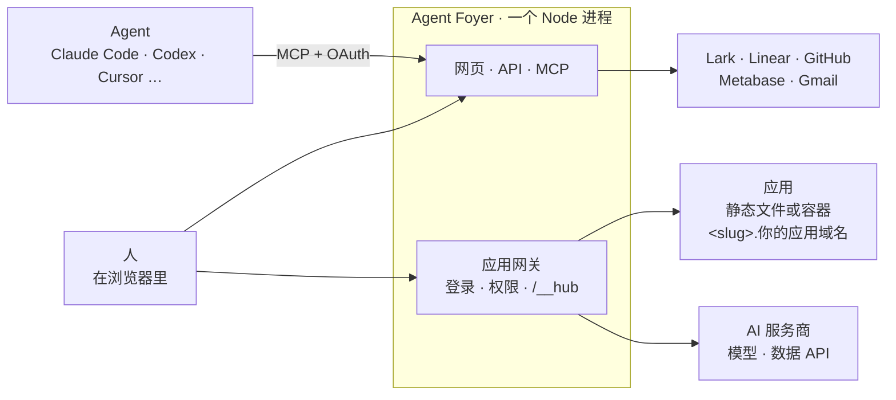

<p align="center">
  <picture>
    <source media="(prefers-color-scheme: dark)" srcset="docs/assets/banner-dark.png">
    
  </picture>
</p>

<p align="center">
  <a href="https://github.com/AIsa-team/agent-foyer/actions/workflows/ci.yml"></a>
  <a href="LICENSE"></a>
  
  
</p>

<p align="center">
  <a href="#快速开始">快速开始</a> ·
  <a href="#五样东西">五样东西</a> ·
  <a href="docs/DEPLOY.zh-CN.md">部署</a> ·
  <a href="CONTRIBUTING.md">参与贡献</a> ·
  <a href="README.md">English</a>
</p>

**一个让 agent 干活的地方。** 你的 agent（Claude Code、Codex、Cursor、云端 agent……）通过 MCP 接入，拿到真正替人干活需要的五样东西：**身份、上下文、发布的地方、资源和护栏**。人做决定，其余交给 agent。

适合任何一起工作、又在用 agent 的人：一家公司、一个团队、一个社区、一个开源项目。

<p align="center">
  
</p>

## 用起来是什么样

> 「做个筛选红人的小工具，名单存在我们的 Lark 表格里，再查一下他们的粉丝数。」

几分钟后，agent 把它发布到了 `creators.<你的应用域名>`，自带登录，只有你选的人能打开。粉丝数通过中台的 AI 资源查询，应用里不放任何 API key。同事的 agent 可以直接往里加红人（`call_app`），你的首页显示本周新增，哪条记录有问题，负责它的人会收到提醒。

整个过程没人填表、没人点后台：每一步都是对 agent 说一句话，网页是给人看结果、做决定的地方。

## 五样东西

| | agent 拿到什么 | |
|---|---|---|
| **身份** | 每个 agent 都以本人的身份、用本人的账号和权限做事 | [↓](#身份每个-agent-都以本人的身份做事) |
| **上下文** | 数据、文档、目标、日程、项目、沉淀成 Skill 的做法、人 | [↓](#上下文agent-需要知道的) |
| **发布的地方** | 独立子域名的应用、首页和看板、数据检查和提醒 | [↓](#发布的地方agent-做出来人和-agent-都能用) |
| **资源** | 给应用用的模型和数据 API、其他工具的 MCP 服务、数据连接 | [↓](#资源模型数据-api-和工具) |
| **护栏** | 每次都按本人权限检查、先征得同意、有限额、key 不经 agent 之手 | [↓](#护栏为什么敢让-agent-动手) |

### 身份：每个 agent 都以本人的身份做事
- 用 Lark 或任意 OpenID Connect 登录（Google Workspace、Microsoft Entra ID、Okta……）。agent 用标准的 MCP OAuth 2.1 接入，不支持 OAuth 的用个人令牌。
- agent 读写 Lark、Linear、GitHub、日历，用的都是本人的账号和权限，永远不会比本人看到的多；应用存邮件草稿，也是存进本人自己的邮箱。
- 每个人能看到自己的每个 agent 是在哪台设备上接入的，可以给它起名字，随时断开。

### 上下文：agent 需要知道的
- **数据**：Lark 多维表格、Metabase 的问题或只读 SQL、应用提供的数据，以及（管理员打开后）把两份数据关联或合并的组合数据源；agent 可以统计、画图、读具体的行（`query_data`、`read_data_rows`）。
- **文档**：搜索、阅读、编辑和新建 Lark 文档与知识库页面。
- **目标和时间**：OKR、本人的日历、Linear 项目和任务、GitHub 动态。
- **把做法沉淀成 Skill**：带版本和更新提醒的 Skill 市场；装不了 Skill 的 agent 直接读来照做（`read_skill`），定时任务每次都用最新版。
- **人**：通讯录、部门和部门主页、同事提的应用需求。

### 发布的地方：agent 做出来，人和 agent 都能用
- **应用**：一句「发布这个」，就把静态网站或容器部署到独立子域名，自带登录，可见范围分为只有自己、指定的人、所有登录的人、公开（管理员审批）。应用的数据存在 Lark 表格里，用的人都能看、能改。
- **应用也给 agent 用**：应用在 `hub-agent.json` 里声明别的 agent 能在里面做什么（查、加、改记录，调用它自己的操作）；agent 用 `list_apps` 找到它，用 `call_app` 以本人身份操作。
- **页面**：agent 用图表、数字、表格、OKR、日程等模块搭首页（个人的、部门的、所有人的）和数据看板（自己的、分享的、部门的）。
- **盯着数据**：指标提醒，以及把每条有问题的记录交给它的负责人的数据检查。
- **一起做**：应用和 Skill 的协作者、给作者的反馈、应用需求池。

<table>
  <tr>
    <td width="50%"></td>
    <td width="50%"></td>
  </tr>
  <tr>
    <td align="center"><sub>agent 发布的应用，每个都有自己的子域名</sub></td>
    <td align="center"><sub>Skill 市场，带版本和更新提醒</sub></td>
  </tr>
</table>

### 资源：模型、数据 API 和工具
- **给应用用的 AI**：应用通过中台调用模型（`/__hub/ai/v1/…`，OpenAI 兼容，支持流式），服务商和 key 由你选：任何 OpenAI 兼容的服务（OpenAI、OpenRouter、自建网关……），或者 [AIsa](https://aisa.one) 这类 AI 资源平台，同一个 key 还能调用数据 API（`/__hub/ai/apis/v1/…`：网页搜索、抓取、社交、金融、SEO……）。每个服务商在 `server/ai.ts` 里是一个小预设，类似的平台很容易加进来。
- **其他工具的 MCP 服务**（Linear、Metabase……）：每个人连自己的账号，或者大家共用一个 key，agent 通过中台使用（`list_connected_tools`、`call_connected_tool`）。
- **数据连接**（目前是 Metabase）：用一个 key 读取，给谁看由管理员决定。

### 护栏：为什么敢让 agent 动手
- 每次读取都按本人权限检查，打开应用的每个请求都重新检查，收回权限立刻生效。
- 应用第一次以某人身份操作 Lark 前要本人同意；agent 被要求在调用会改东西的工具前先跟人确认。
- key 只在管理页填写，加密保存，不再显示，也不会交给 agent 或应用。
- AI 调用按应用、按人每天限额，带 token 数记录，而且必须是登录的人：公开应用不会替陌生人花你的额度。agent 写的 SQL 只能读。
- 应用跑在各自的容器里，限制内存、CPU 和进程数，不给任何特权。管理员可以关掉某个工具、某个应用的 AI，或整个服务。

## 接你已经在用的平台

平台以**渠道**的方式接入（`server/channels.ts`）。Lark 是第一个：登录、通讯录、多维表格、OKR、文档、日历、机器人消息。不用 Lark 的话，用 OpenID Connect 登录，核心功能都在：应用、Skill、agent、页面、数据应用和数据连接、检查、提醒、AI 资源（[docs/OIDC_SETUP.zh-CN.md](docs/OIDC_SETUP.zh-CN.md)）。接一个新平台就是加一个渠道：它的通讯录和数据源类型，各实现一个小接口（见 [CONTRIBUTING.md](CONTRIBUTING.md)）。

界面上所有文字都有中英文，加一种语言只要加一个词条文件。

## 怎么运作



- **一个进程，按域名分流。** 中台自己的域名进网页和接口，应用子域名进网关。反向代理只负责 TLS，加应用不用改它的配置。
- **存储**：SQLite（`data/hub.db`），加上 `data/` 下的应用文件、Skill 包和图标。
- **应用登录**：网关把访客送到中台确认身份，再带一次性的码回到应用子域名，换成只属于这个子域名的 cookie。应用从 `X-Hub-User-*` 请求头知道是谁，浏览器里用 `fetch('/__hub/me')`；应用的服务端带上这次请求的 `X-Hub-Ticket` 调用中台。
- **两种应用**：`static`（构建好的文件，支持单页应用路由）和 `container`（自带 Dockerfile，Node 和 Python 项目可自动生成），各自在只有中台能访问的 Docker 网络里，带持久的 `/data` 和加密的环境变量。
- **agent** 通过 MCP 拿到中台的工具和说明，中台更新后会提醒它。

## 快速开始

### 让 agent 帮你装

把下面这段发给你的 agent（Claude Code、Codex、Cursor……）：

```text
帮我在这台机器上装好 Agent Foyer：https://github.com/AIsa-team/agent-foyer

1. 把仓库克隆下来。它需要 Node >= 22.18 和 pnpm，缺哪个告诉我。
2. 运行 `pnpm install` 和 `pnpm build`，再在后台用 `pnpm dev` 启动，等 http://localhost:8080 能打开。
   没配登录时是开发登录，带三个测试用户。
3. 把它作为远程 MCP 服务器接到你这里，名字用 agent-foyer，地址 http://localhost:8080/mcp（HTTP，用 OAuth 登录）：
   - Claude Code：运行 `claude mcp add --transport http --scope user agent-foyer http://localhost:8080/mcp`，
     然后提醒我输入 /mcp，选 agent-foyer 完成登录。
   - Codex：运行 `codex mcp add agent-foyer --url http://localhost:8080/mcp`，再运行 `codex mcp login agent-foyer`。
   - 其他 agent：把地址按 HTTP / Streamable HTTP 类型加进去，按提示登录。
   如果要重启才能看到它的工具，告诉我。
4. 调用它的 whoami 工具，再用几句话告诉我可以让你用它做什么。
```

要给团队部署到服务器上，让 agent 带着你照 [docs/DEPLOY.zh-CN.md](docs/DEPLOY.zh-CN.md) 来做。

### 或者手动

需要 Node ≥ 22.18（直接运行 TypeScript，不用编译）和 pnpm。

```bash
pnpm install
pnpm build          # 构建网页
pnpm dev            # http://localhost:8080 ，没配登录时是开发登录，带三个测试用户
pnpm dev:web        # 可选：Vite 热更新 http://localhost:5173 ，接口转发到 8080
```

接入一个 agent：

```bash
claude mcp add --transport http agent-foyer http://localhost:8080/mcp
```

### 然后

其他人在中台里接入就行：「我的」页面有一句现成的话，带着中台地址和登录方式，复制给自己的 agent，它会自己接上。

让应用能用模型和数据 API：管理页「AI 资源」里选一个服务商：AIsa（一个 key 同时有模型和数据 API，在 [console.aisa.one](https://console.aisa.one/api-keys) 申请），或者任意 OpenAI 兼容服务的地址和 key。

应用的地址是 `http://<slug>.apps.localhost:8080`。容器应用需要 Docker。

## 测试

```bash
pnpm test           # 类型检查 + 端到端测试（假的 Lark、Metabase、Linear、AIsa 和 OIDC）
pnpm smoke          # 对运行中的中台做核心端到端测试：pnpm smoke http://localhost:8080 [--docker]
```

## 部署

先看 [docs/DEPLOY.zh-CN.md](docs/DEPLOY.zh-CN.md)，再看 [docs/LARK_SETUP.zh-CN.md](docs/LARK_SETUP.zh-CN.md) 或 [docs/OIDC_SETUP.zh-CN.md](docs/OIDC_SETUP.zh-CN.md)。请先读 [SECURITY.md](SECURITY.md)：中台会运行 agent 写的代码，并持有宿主机的 Docker socket。

## 改成你自己的

都在 `.env` 里（见 [.env.example](.env.example)）；AI 服务商和数据连接在管理页设置。

| 配置 | 作用 |
|---|---|
| `COMPANY_NAME` | 界面和消息里显示的名字 |
| `HUB_BRAND_DIR` | 放你的 `logo.svg`、`app-icon.svg`、`motif.svg` 的文件夹 |
| `HUB_ACCENT` | 按钮、高亮和图表重点系列的颜色 |
| `HUB_DESIGN_SKILLS` | 放你们设计规范的 Skill；agent 做界面前先装上 |
| `HUB_MCP_NAME` | agent 注册 MCP 服务时用的名字 |
| `HUB_TIMEZONE` | 日期、免打扰时段、汇总消息，以及图表里的周、月边界 |
| `DEFAULT_LOCALE` | 没选语言的人默认看到的语言 |

默认主题（`web/src/brand/` 里的设计变量、组件、图表和字体）来自 [AIsa](https://aisa.one) 设计系统：开箱就是一套完整的设计系统，agent 做页面和应用时也照着它来。用 `HUB_ACCENT` 换颜色，在 `HUB_BRAND_DIR` 里放你自己的标志。

## 致谢

这个想法来自 [数字生命卡兹克](https://x.com/Khazix0918/status/2108800048050106751) 的文章《我花了5天时间，对公司进行了一场AI化改造》，讲的是为虚实传媒自建的中台：以 Agent 操作为原生、以飞书的原始数据为基建，每个人都 Vibe Coding 自己和同事要用的工具。Agent Foyer 是我们对这个想法的实现，代码从头写起，开源给所有在用 agent 的人。

## 许可证

[Apache-2.0](LICENSE)。附带的字体（Inter、JetBrains Mono、Plus Jakarta Sans）使用 SIL Open Font License 1.1，见 `web/src/brand/`。
